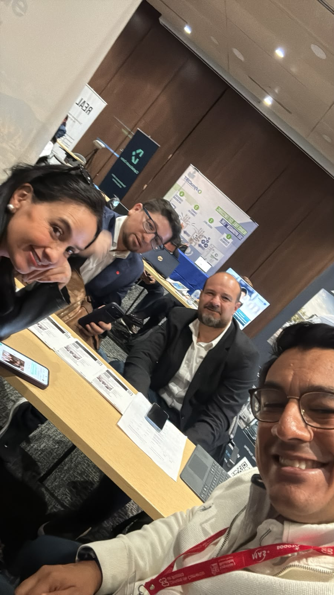

Hoy estamos en **MAS+ 2026: Movilidad, Articulación y Sostenibilidad**, un encuentro que reúne al sector del transporte de carga, empresas proveedoras, entidades públicas, academia y otros actores de la logística en Bogotá-Región.

La jornada se realiza en la **Cámara de Comercio de Bogotá, sede Salitre**, con una agenda alrededor de la innovación, la movilidad sostenible y las soluciones que pueden ayudar a transformar la operación del transporte de carga.

<figure class="post-figure">
  
  <figcaption>Una jornada para conversar sobre movilidad, sostenibilidad y las decisiones que necesita el transporte de carga.</figcaption>
</figure>

## Conectar soluciones con problemas reales

MAS+ integra la Feria de Tecnologías y Movilidad Sostenible para el Transporte de Carga con el Encuentro Anual del Clúster de Logística y Movilidad de la Cámara de Comercio de Bogotá. El propósito es acercar al sector a tecnologías, servicios, conocimiento y alternativas de financiación que puedan convertirse en proyectos concretos.

La transformación del transporte no ocurre únicamente con una nueva tecnología. También exige mejores conversaciones entre transportadores, proveedores, entidades públicas, universidades y empresas que conocen los retos de la operación diaria.

## Una conversación necesaria para Bogotá-Región

La agenda pone sobre la mesa temas como la renovación de flotas, las tecnologías de cero y bajas emisiones, la eficiencia energética, la seguridad vial, la formación y el acceso a financiación. Son asuntos distintos, pero están conectados por una misma pregunta: **¿cómo hacemos que el transporte de carga sea más sostenible, seguro y eficiente sin perder de vista la realidad de quienes lo operan?**

En ATIEMPPO nos interesa participar en estos espacios porque nuestro trabajo parte de esa conexión entre datos, transporte y decisiones. La tecnología tiene sentido cuando ayuda a entender mejor una operación, comparar alternativas y avanzar hacia acciones posibles.

Gracias a la Cámara de Comercio de Bogotá y a las secretarías distritales de Movilidad y Ambiente por abrir este espacio de encuentro para el sector.

[Conoce más sobre MAS+ en la Secretaría Distrital de Movilidad](https://www.movilidadbogota.gov.co/noticias/mas-encuentro-que-reunira-innovacion-sostenibilidad-y-soluciones-para-transformar-el) · [Conoce las conferencias de ATIEMPPO](https://atiemppo.com/conferencias/) · [Conversemos](https://atiemppo.com/contacto/?servicio=conferencias)
