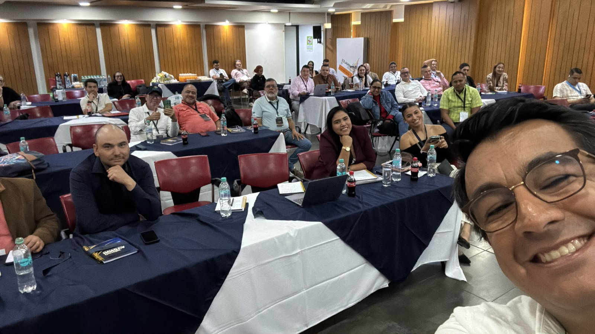

Hoy estamos en **CONALTER**, reunidos con terminales de pasajeros para compartir información, experiencias y posibilidades concretas de la **inteligencia artificial** aplicada al sector.

Las terminales son mucho más que lugares de llegada y salida. Son infraestructuras donde se cruzan viajeros, empresas transportadoras, conductores, equipos de operación, autoridades y comunidades. Cada día producen información valiosa sobre demanda, despachos, atención al usuario, recaudo, seguridad y gestión de recursos.

<figure class="post-figure">
  
  <figcaption>Conversaciones con las terminales de pasajeros sobre datos, operación e inteligencia artificial.</figcaption>
</figure>

## De la conversación a las posibilidades

La inteligencia artificial puede ayudar a las terminales a consultar mejor su información, identificar patrones, automatizar tareas repetitivas y convertir grandes volúmenes de datos en señales útiles para decidir.

Algunas posibilidades que estamos conversando incluyen:

- asistentes para consultar procedimientos, reglamentos e información operativa;
- análisis de demanda, despachos y comportamiento de los servicios;
- apoyo a la atención de viajeros, empresas y conductores;
- identificación de novedades y alertas para los equipos responsables;
- automatización de reportes, documentos y tareas administrativas;
- herramientas para compartir conocimiento entre terminales y aprender de experiencias comunes.

No se trata de poner tecnología por ponerla. El punto de partida es entender cómo funciona cada terminal, qué información existe, qué decisiones necesitan apoyo y dónde una solución puede generar valor sin agregar complejidad innecesaria.

## Inteligencia artificial con sentido operativo

Una buena conversación sobre IA empieza por los procesos y las personas. Requiere datos confiables, reglas claras, protección de la información y pilotos que permitan aprender antes de escalar.

También exige reconocer el conocimiento de quienes hacen posible la operación todos los días. La tecnología debe ampliar su capacidad de análisis y respuesta, no desconocer la experiencia que ya existe en las terminales.

En ATIEMPPO compartimos herramientas y metodologías para que organizaciones públicas, gremios y empresas puedan entender mejor sus retos, explorar el potencial de la inteligencia artificial y convertirlo en soluciones prácticas.

Gracias a CONALTER y a las terminales de pasajeros por abrir este espacio de conversación. La transformación empieza cuando compartimos información y hacemos mejores preguntas juntos.

[Conoce más sobre CONALTER](https://www.conalter.co/) · [Conoce las conferencias de ATIEMPPO](https://atiemppo.com/conferencias/) · [Conversemos](https://atiemppo.com/contacto/?servicio=conferencias)
