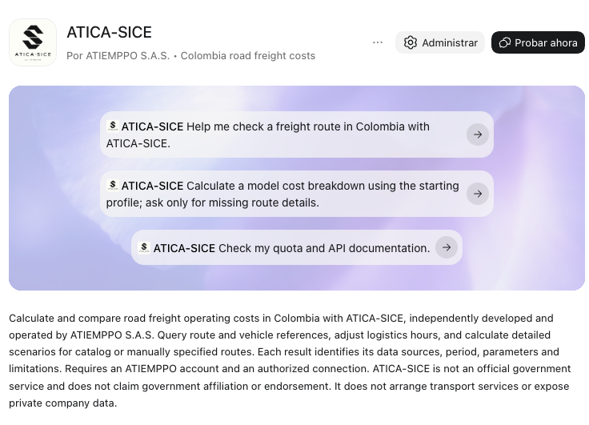
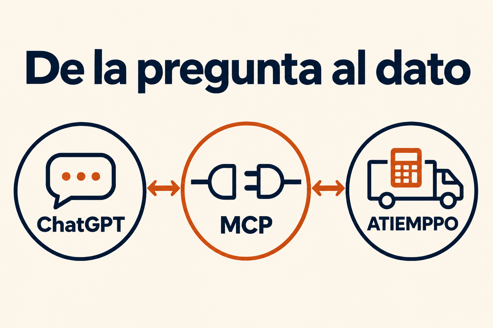

<figure>

<figcaption>Imagen ilustrativa generada con IA.</figcaption>
</figure>

¿Cuál es el costo de referencia de llevar una carga de Bogotá a Cartagena en tractomula? ¿Cuánto cambia si el vehículo pasa más tiempo esperando para cargar o descargar?

Desde ATIEMPPO llevamos esas preguntas a ChatGPT con **ATICA-SICE**, el complemento que conecta una conversación con **SICETAC al Instante**, nuestro servicio de consulta de costos de transporte terrestre de carga en Colombia. OpenAI aprobó el complemento y su ficha ya está en el directorio público de ChatGPT. [Ver ATICA-SICE en ChatGPT](https://chatgpt.com/plugins/plugin_asdk_app_6ad2f4ab50f88191a8c81279e7c1b32c).

<figure>

</figure>

## ¿Qué instalas y qué pasa cuando preguntas?

Un **plugin**, o **complemento**, es algo que puedes agregar a ChatGPT para darle una capacidad adicional. En este caso, instalas ATICA-SICE y autorizas la conexión con tu cuenta de ATIEMPPO. Así, el chat puede consultar rutas y pedir resultados al servicio de costos. [Guía de complementos de ChatGPT](https://help.openai.com/en/articles/20001256-plugins-in-chatgpt).

**MCP** significa *Model Context Protocol*. Es un estándar abierto que permite que un asistente de IA se comunique con una herramienta externa. Piensa en un enchufe común. El complemento es lo que instalas. MCP es la forma en que ChatGPT envía una consulta a ATIEMPPO y recibe la respuesta. La conexión funciona detrás del chat y tú escribes como siempre. [Introducción a MCP](https://modelcontextprotocol.io/docs/getting-started/intro).

<figure>

<figcaption>Cuando eliges ATICA-SICE, ChatGPT organiza tu pregunta, ATIEMPPO consulta la referencia o realiza el cálculo y ChatGPT te muestra el resultado.</figcaption>
</figure>

## ¿Qué puedes hacer con el resultado?

Puedes pedir **una referencia publicada para una ruta**, cuando esté disponible, o **un cálculo de escenario** para ver cómo se compone el costo. Una empresa de transporte puede revisar qué pesa más en el cálculo. Un generador de carga puede preparar un presupuesto inicial. Un equipo de operaciones puede comparar cuánto cambia el costo proyectado al pasar de cuatro a ocho horas de espera, cargue y descargue, manteniendo los demás datos del viaje.

Revisa **la fuente, el mes y las condiciones del viaje** que usó el servicio. ATICA-SICE es una herramienta independiente de ATIEMPPO. El **SICE-TAC** es el sistema oficial del Ministerio de Transporte. Para una decisión de cumplimiento, contrasta el resultado con la consulta oficial del viaje. [Manual de consulta del SICE-TAC](https://sicetac.mintransporte.gov.co/SiceTAC/Manual-de-consulta-del-SICE-TAC).

## ¿Qué cambia al estar en el directorio público?

Para ATIEMPPO, el directorio abre un canal de distribución. Cualquier persona que tenga disponible el complemento puede encontrarlo por nombre, ver quién lo desarrolla y abrir su ficha desde ChatGPT. Para el sector, eso baja la barrera de entrada. Un despachador, un analista o un equipo de compras puede probar una ruta con una cuenta propia y una pregunta escrita en sus palabras.

El acceso depende de la disponibilidad en tu cuenta de ChatGPT y de las reglas de tu organización si usas un espacio de trabajo empresarial. La conexión requiere autorización con tu cuenta de ATIEMPPO. [Guía de conexión de cuentas en ChatGPT](https://help.openai.com/en/articles/20001494-connecting-and-managing-app-accounts-in-chatgpt).

## ¿Cómo funcionan las 100 consultas gratis?

Las cuentas nuevas verificadas y activadas que cumplan las condiciones del plan reciben **hasta 100 consultas exitosas gratis por mes calendario**, en hora de Colombia. Puedes usarlas en cualquier ruta que cubra el servicio. El saldo es personal, se comparte entre ChatGPT y las demás integraciones personales y se renueva al comenzar el mes. Las consultas sobrantes vencen y el plan funciona sin cobros automáticos. [Registro y condiciones del plan de ATIEMPPO](https://clientes.atiemppo.com/registro?service=instant).

Cada referencia o cálculo exitoso usa una consulta. Recalcular con otras horas usa otra. Ver tu saldo, buscar rutas o recibir una aclaración conserva tu cupo.

## Busca ATICA-SICE y prueba una ruta

<figure>

<figcaption>Encuentra el complemento en ChatGPT y autoriza tu cuenta de ATIEMPPO para empezar.</figcaption>
</figure>

1. Abre la ficha de **ATICA-SICE** en Complementos de ChatGPT y selecciona **Instalar** si la opción aparece. [Abrir la ficha](https://chatgpt.com/plugins/plugin_asdk_app_6ad2f4ab50f88191a8c81279e7c1b32c).
2. Cuando ChatGPT te pida conectar el servicio, entra con tu cuenta de ATIEMPPO y autoriza la conexión. Si todavía no tienes cuenta, puedes crearla y verificar tu correo. [Crear cuenta de ATIEMPPO](https://clientes.atiemppo.com/registro?service=instant).
3. Abre un chat, selecciona **ATICA-SICE** y prueba con esta pregunta.

> Con ATICA-SICE, consulta la referencia SICETAC de Bogotá a Cartagena para una tractomula C3S3 cargada, con carga general en estacas y cuatro horas logísticas. Muéstrame el costo por viaje, el mes y la fuente.

Para aislar el efecto de las horas de espera, cargue y descargue, compara dos escenarios del mismo modelo.

> Con la misma ruta, vehículo, carga y mes, calcula dos escenarios del modelo, uno con cuatro horas logísticas y otro con ocho. ¿Cuánto cambia el costo por viaje?

**Si haces parte de El Dato Logístico, te invitamos a probar con una ruta que conozcas bien.** Responde a esta edición y cuéntanos qué preguntaste, qué te sirvió de la respuesta y qué te gustaría consultar después.

[**Probar ATICA-SICE en ChatGPT**](https://chatgpt.com/plugins/plugin_asdk_app_6ad2f4ab50f88191a8c81279e7c1b32c)
