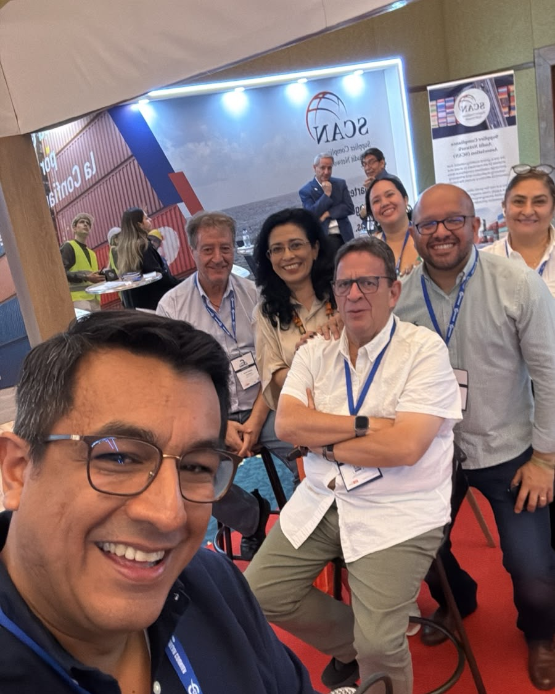

Hay fotografías que sirven para recordar un evento. Otras ayudan a leer el trabajo que ocurre detrás de un sector. Esta imagen, tomada durante **FITAC**, muestra una escena sencilla y poderosa: personas reunidas, credenciales al cuello, una conversación que se graba y la pausa necesaria para encontrarse en medio de una agenda intensa.

<figure>

<figcaption>Una conversación durante FITAC. Foto: Juan Pablo Matiz.</figcaption>
</figure>

La foto no basta para atribuir nombres, cargos o conclusiones particulares a quienes aparecen en ella. Tampoco hace falta inventarlos. Lo que sí permite ver es el valor del encuentro: un sector que se reconoce, comparte preguntas y busca mejores formas de mover lo que sostiene la vida cotidiana.

## La comunidad también es infraestructura

La logística suele contarse con cifras: toneladas, viajes, tiempos, costos, corredores y niveles de servicio. Todo eso importa. Pero ninguna operación mejora solamente porque tenga más datos. Mejora cuando las personas que conocen el problema pueden poner esos datos en conversación.

Un congreso como FITAC funciona, en ese sentido, como una infraestructura temporal de confianza. Allí aparecen preguntas que no siempre llegan a un tablero:

- ¿Qué está cambiando realmente en la operación?
- ¿Qué información falta para decidir con menos incertidumbre?
- ¿Qué parte del proceso puede apoyarse en tecnología sin perder criterio?
- ¿Cómo se comparte una señal antes de que se convierta en un problema mayor?

La respuesta no está en una herramienta aislada. Está en conectar experiencia, fuentes confiables y una decisión concreta.

## Del encuentro a la decisión

En ATIEMPPO trabajamos con una idea simple: la inteligencia artificial y los datos tienen sentido cuando ayudan a hacer mejor una tarea real. Eso exige empezar por el contexto, revisar la calidad de la información y dejar claro qué sabe el sistema, qué está interpretando y qué debe validar una persona.

La conversación de una feria puede convertirse en una primera prueba si se conserva ese orden:

1. **Nombrar la pregunta.** No “usar IA”, sino resolver una tarea específica de transporte, logística o gestión.
2. **Asegurar las fuentes.** Separar el dato operativo, la referencia histórica, la señal de novedades y la opinión.
3. **Probar con un caso real.** Medir si la respuesta ahorra tiempo, mejora el criterio o evita una confusión.
4. **Decidir qué queda en manos humanas.** La automatización no elimina la responsabilidad: la vuelve más visible.

Ese recorrido evita dos errores frecuentes: convertir una conversación en una promesa tecnológica o convertir un dato en una certeza que no puede sostener.

## Lo que nos llevamos de FITAC

Más que una lista de contactos, un encuentro como este deja conexiones entre problemas y capacidades. Una pregunta sobre rutas puede abrir una conversación sobre datos. Una conversación sobre datos puede revelar una decisión que todavía se toma a ciegas. Y una decisión concreta puede ser el comienzo de un proyecto pequeño, verificable y útil.

La foto registra un momento. El trabajo empieza después: volver a la operación, escoger una pregunta y probar una mejora que pueda ser revisada por quienes conocen el negocio.

Si estás en FITAC y quieres conversar sobre datos, inteligencia artificial aplicada y transporte, [hablemos con ATIEMPPO](https://atiemppo.com/contacto/?servicio=sesion-personalizada).

> Esta publicación es una lectura editorial de la fotografía y del encuentro. No es una transcripción oficial del evento ni una identificación de las personas que aparecen en la imagen.
